# EDA summary

Generated by `src/eda.py` from the SQL database.

## Univariate

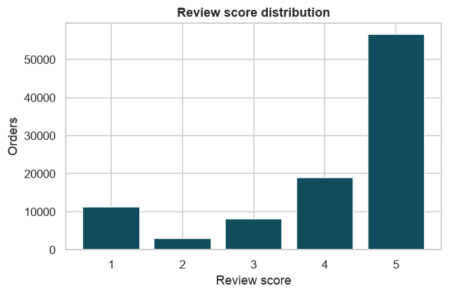

**Finding:** 57.8% of reviews are 5 stars and 11.5% are 1 star; the average is 4.09.

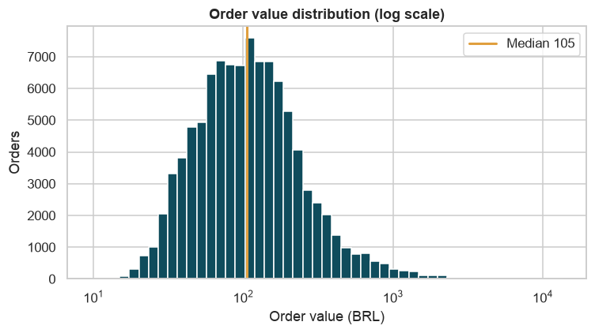

**Finding:** Order values are right-skewed: median 105.28, mean 160.24, 95th percentile 449.48 BRL.

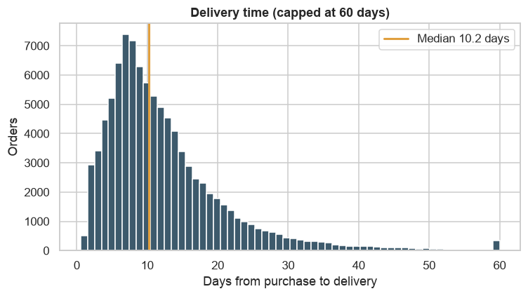

**Finding:** Median delivery takes 10.2 days; 4.7% of deliveries take more than 30 days.

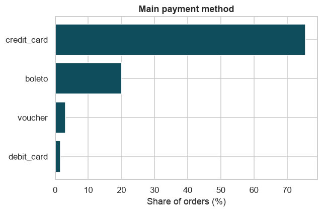

**Finding:** credit card is the main method for 75.5% of orders.

## Bivariate

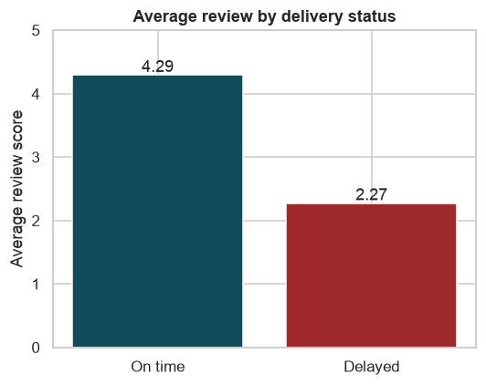

**Finding:** On-time orders average 4.29 stars vs 2.27 for delayed orders, a gap of 2.02.

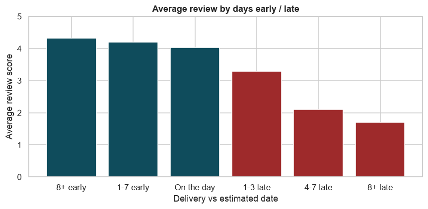

**Finding:** Reviews fall steadily with lateness: 4.32 for orders 8+ days early vs 1.70 for orders 8+ days late.

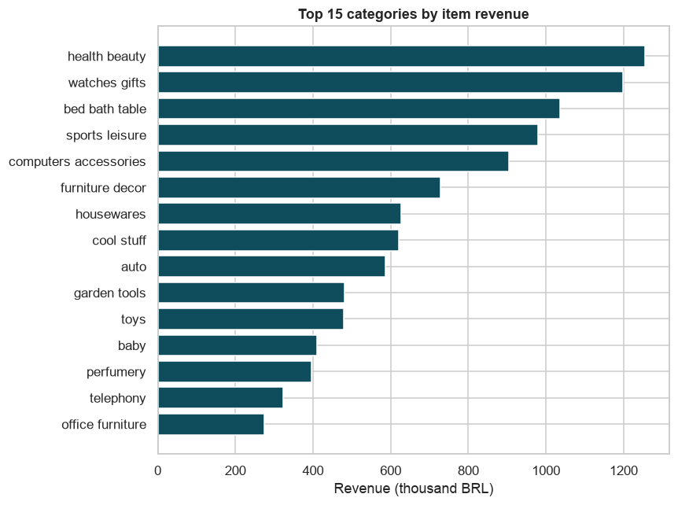

**Finding:** The top 15 of 74 categories earn 76.3% of item revenue; the largest is health beauty.

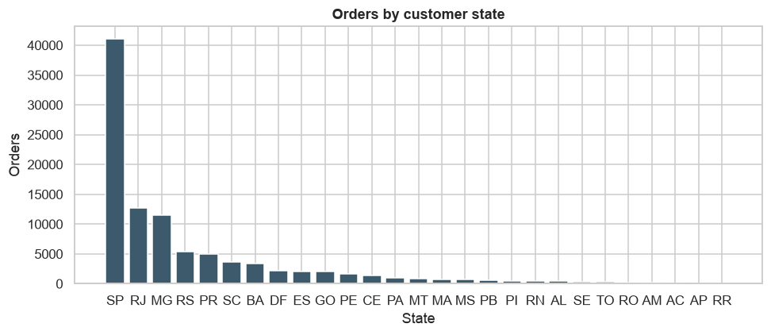

**Finding:** SP, RJ, MG together place 66.5% of all orders.

## Trend

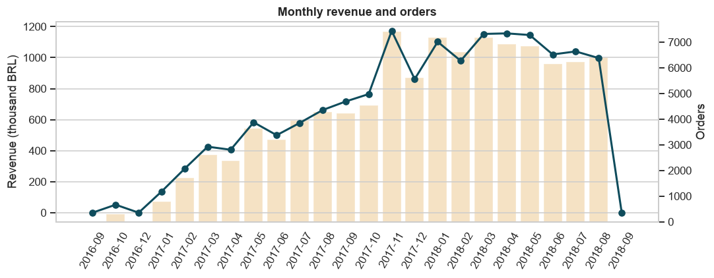

**Finding:** Revenue peaks in 2017-11 at 1,172,192 BRL (7,421 orders). Check the first and last months: they may be partial.

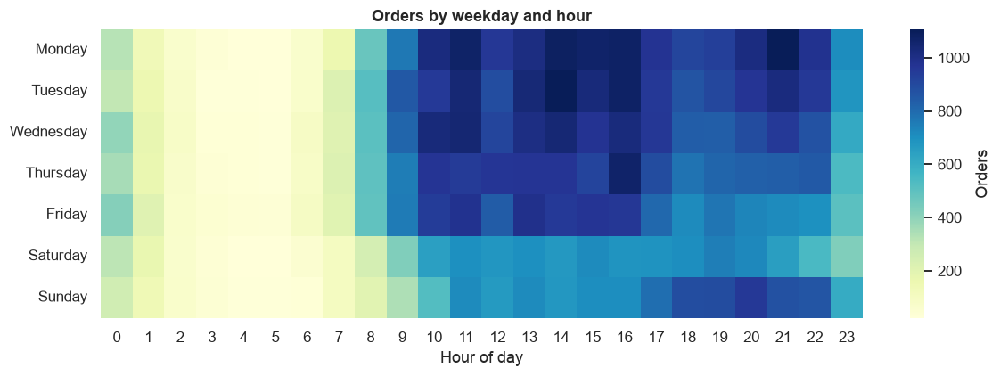

**Finding:** Monday is the busiest day and 16:00 the busiest hour for purchases.

## Multivariate

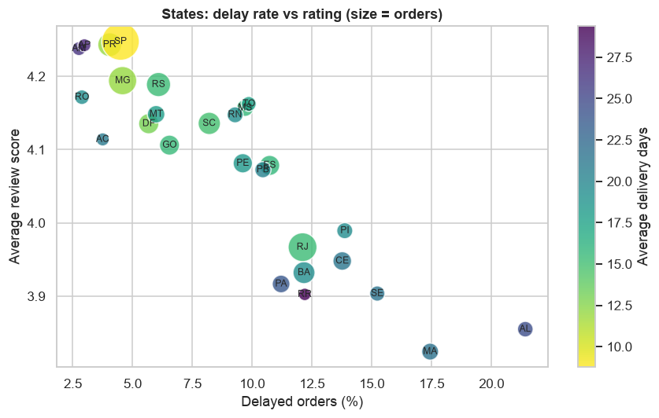

**Finding:** Across states, delay rate and average rating have a correlation of -0.89; AL has the highest delay rate (21.4%).

## Correlation

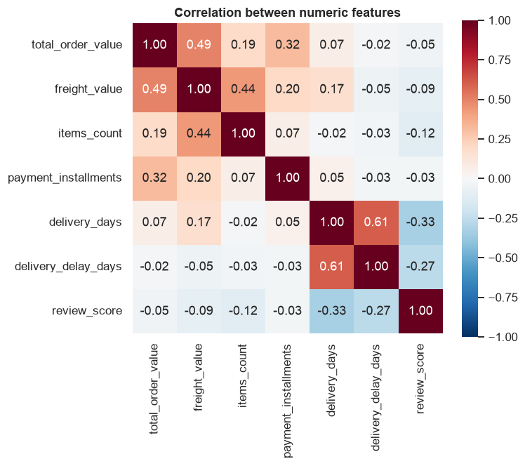

**Finding:** The feature most correlated with review score is delivery days (r = -0.33).
